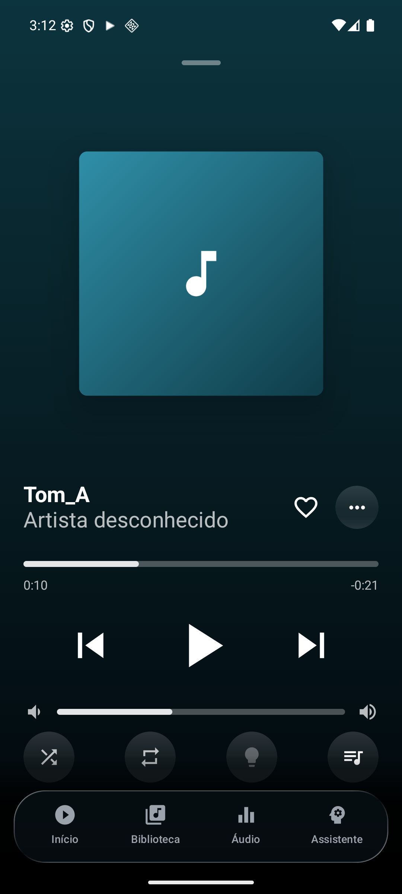
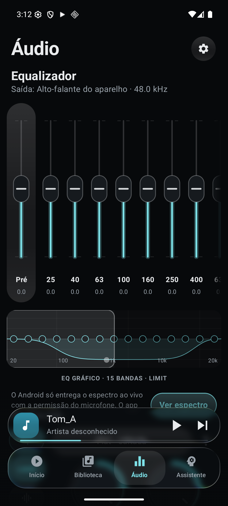
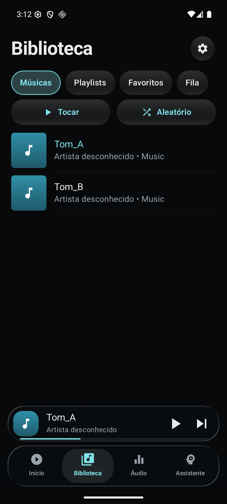

<p align="center">
  
</p>

<h1 align="center">T.A.R.K.A.S.</h1>

<p align="center"><b>TOTALLY ACCURATE REAL-TIME KIND OF AUDIO SYSTEM</b></p>

<p align="center">Music player and audio hub for Android.</p>

<p align="center">
  <a href="https://github.com/TODDYNDOSVRAU/T.A.R.K.A.S/releases/latest"></a>
  
  <a href="LICENSE"></a>
</p>

<p align="center">
  
  
  
</p>

## Features

**Playback**
- On-device music, Audius, YouTube Music and Spotify in one unified search
- Background playback with controls in the notification, lock screen, headphones and Bluetooth
- Gapless, queue, shuffle, repeat, favorites and playlists
- Queue and position restored on relaunch
- Sleep timer

**Equalizer**
- 15-band graphic or parametric (frequency, gain and Q)
- Headphone correction by model ([AutoEq](https://github.com/jaakkopasanen/AutoEq))
- Bass, treble, balance, stereo width, limiter and auto preamp
- System-wide EQ for other apps via ADB or root

**Song facts**
- Verified facts about the playing track, in the player and the notification

## Installation

Download the APK from the [latest release](https://github.com/TODDYNDOSVRAU/T.A.R.K.A.S/releases/latest) and install it. Updates install over the previous version without data loss.

The app interface is in Brazilian Portuguese.

**EQ for other apps (ADB)**

```bash
adb shell pm grant com.aistudio.tarkas.app android.permission.DUMP
```

Then select **ADB** under Áudio > Ajustes avançados > Alcance. On rooted devices, select **Root**.

## Privacy

No account and no backend. Data stays on the device. Searches are sent to the services queried (Audius, YouTube Music, Spotify). The full privacy policy is available in the app.

## Limitations

- The EQ does not apply to YouTube Music and Spotify audio.
- Spotify: sign-in and playback not yet validated.
- ADB mode depends on the device manufacturer and the source app.

## Roadmap

Per-device profiles, 5.1/7.1 multichannel, album and artist pages, synced lyrics and a context-aware AI assistant. See [docs/VISAO.md](docs/VISAO.md) (Portuguese).

## Tech

Kotlin · Jetpack Compose · Material 3 · AndroidX Media3 · Coil · OkHttp · custom DSP (biquad filters, lookahead limiter)

## License

All rights reserved. Personal use of the official APKs is permitted; copying, modification, redistribution and commercial use are prohibited without written permission. See [LICENSE](LICENSE) (Portuguese).

## Contact

Roger Moreira · roger.moreiraa8@gmail.com
